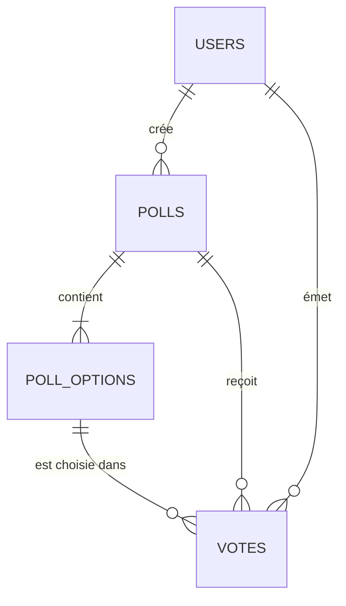

<div align="center">


### 🗳️ Votez · 📊 Suivez les résultats en direct · 🤖 Générez vos sondages avec l'IA

<br/>


<br/>

| 🎓 Formation | 👨‍🏫 Encadrant | 👩‍💻 Réalisé par |
|:---:|:---:|:---:|
| **DAIA 2026-2027** | **Pr Filali Reda** | **Salma EL QADI** & **Meryem RESOUANE** |

</div>

---

> **Projet de développement web** — Conception et réalisation d'une plateforme intelligente de vote et de sondage en ligne en temps réel, basée sur **Next.js**, **Node.js / Express.js**, **Socket.IO**, **PostgreSQL** et l'**intelligence artificielle générative**.

---

## 📑 Table des matières

1. [Objectif du projet](#1-objectif-du-projet)
2. [Fonctionnalités principales](#2-fonctionnalités-principales)
3. [Technologies utilisées](#3-technologies-utilisées)
4. [Architecture du projet](#4-architecture-du-projet)
5. [Base de données](#5-base-de-données)
6. [Relations entre les tables](#6-relations-entre-les-tables)
7. [Événements Socket.IO](#7-événements-socketio)
8. [API REST (aperçu)](#8-api-rest-aperçu)
9. [Installation et lancement](#9-installation-et-lancement)
10. [Variables d'environnement](#10-variables-denvironnement)
11. [Sécurité](#11-sécurité)
12. [Gestion des erreurs](#12-gestion-des-erreurs)
13. [Travail demandé](#13-travail-demandé)

---

## 1. Objectif du projet

L'objectif est de concevoir et développer une **plateforme web interactive** permettant aux utilisateurs de :

- créer des sondages ;
- participer à des votes ;
- consulter les résultats **en temps réel**.

La plateforme intègre une fonctionnalité d'**IA générative** qui génère automatiquement des questions de sondage et leurs propositions de réponse à partir d'un **thème** fourni par l'utilisateur.

Elle utilise **Socket.IO** pour assurer la mise à jour instantanée des résultats et la transmission de notifications aux utilisateurs connectés, notamment lors de la clôture d'un sondage.

Le système garantit :

- la sécurité des opérations de vote ;
- l'interdiction des votes multiples d'un même utilisateur pour un même sondage ;
- une gestion appropriée des erreurs.

---

## 2. Fonctionnalités principales

### 2.1. Inscription et authentification

- Inscription, connexion et déconnexion.
- Gestion et modification des profils utilisateurs.
- Distinction entre **administrateurs** et **utilisateurs ordinaires** selon leurs autorisations.
- Mots de passe **hachés**.
- Authentification **obligatoire** pour participer aux votes.

### 2.2. Création et gestion des sondages

- Création manuelle d'un sondage (question + propositions de réponse).
- Nombre de propositions variable.
- Définition d'une **date et heure de clôture**.
- Consultation et gestion des sondages créés, puis **publication après validation**.
- Durée limitée : le serveur vérifie que le sondage est toujours ouvert avant d'accepter un vote.

### 2.3. Génération intelligente de sondages par IA

1. L'utilisateur saisit un **thème** et peut préciser le **nombre de propositions** souhaitées.
2. Le serveur Node.js transmet les informations à une **API d'IA générative** (ex. OpenRouter).
3. L'IA génère une **question pertinente** et plusieurs **propositions cohérentes**, claires et neutres.
4. L'application affiche le résultat : l'utilisateur peut **vérifier, modifier ou régénérer**.
5. Après validation, le sondage est enregistré dans **PostgreSQL** et peut être publié.

> ⚠️ La réponse de l'IA doit être structurée en **JSON**. L'appel à l'API est réalisé **côté serveur uniquement** : la clé API n'est **jamais** exposée dans le frontend.

Exemple de format JSON attendu :

```json
{
  "question": "Quel langage de programmation préférez-vous pour le développement web ?",
  "options": ["JavaScript", "Python", "PHP", "Java"]
}
```

### 2.4. Participation aux votes

- Consulter les sondages ouverts (questions et propositions).
- Sélectionner une proposition et soumettre un vote.
- Consulter les résultats selon les paramètres du sondage.
- Vérification **côté serveur** : sondage ouvert et utilisateur n'ayant pas déjà voté.
- Chaque vote accepté est enregistré dans PostgreSQL.

> Un utilisateur authentifié ne peut voter **qu'une seule fois par sondage**.

### 2.5. Résultats en temps réel avec Socket.IO

- Actualisation des résultats **sans rechargement** de la page.
- Après chaque vote validé, le serveur recalcule les statistiques et diffuse les résultats.
- Affichage sous forme de **tableaux**, **barres de progression** ou **graphiques**.
- Utilisation **obligatoire des rooms Socket.IO** pour isoler les communications de chaque sondage.
- Mises à jour envoyées **uniquement aux clients concernés**.

### 2.6. Clôture automatique des sondages

- Clôture à la date et à l'heure définies.
- Refus de tout nouveau vote après la clôture.
- Notification en temps réel des utilisateurs concernés via Socket.IO.
- Résultats définitifs accessibles selon les règles de visibilité du sondage.
- Vérification de la date de clôture **côté serveur**, indépendamment de l'envoi des notifications.

### 2.7. Consultation des résultats

- Nombre total de votes.
- Nombre de votes et **pourcentage** de chaque proposition.
- Résultats en temps réel ou après clôture, selon le mode choisi.
- Résultats définitifs des sondages clôturés.
- Calculs statistiques réalisés par l'application à partir des données PostgreSQL.

### 2.8. Gestion des erreurs

- Erreurs de saisie et tentatives de connexion incorrectes.
- Tentatives de vote multiple ou vote après clôture.
- Erreurs de connexion à la base de données.
- Indisponibilité de l'API d'IA ou réponse invalide / mal structurée.
- Erreurs de communication en temps réel, routes inexistantes et erreurs internes du serveur.

Les messages affichés sont explicites **sans divulguer d'informations sensibles**.

---

## 3. Technologies utilisées

| Couche | Technologie |
|---|---|
| **Frontend** | Next.js (React), HTML5, CSS3, JavaScript |
| **Backend** | Node.js, Express.js |
| **Temps réel** | Socket.IO (avec rooms) |
| **Base de données** | PostgreSQL |
| **Intelligence artificielle** | API d'IA générative (ex. OpenRouter) |
| **Authentification** | JWT, bcrypt |

---

## 4. Architecture du projet

```
projet-vote-sondage/
├── backend/
│   ├── src/
│   │   ├── config/          # Configuration (DB, IA, variables d'environnement)
│   │   ├── controllers/     # Logique des routes
│   │   ├── middlewares/     # Authentification, rôles, gestion des erreurs
│   │   ├── models/          # Accès aux données PostgreSQL
│   │   ├── routes/          # Routes Express (auth, polls, votes, ai)
│   │   ├── services/        # Service IA, calcul des résultats, clôture automatique
│   │   ├── sockets/         # Gestion Socket.IO (rooms, événements)
│   │   └── server.js        # Point d'entrée
│   ├── database/
│   │   └── schema.sql       # Script de création des tables
│   ├── .env.example
│   └── package.json
│
├── frontend/                # Application Next.js
│   ├── app/                 # Pages et routes
│   ├── components/          # Composants réutilisables
│   ├── lib/                 # Client API, client Socket.IO
│   ├── .env.local.example
│   └── package.json
│
└── README.md
```

---

## 5. Base de données

### Table `users`

| Champ | Description |
|---|---|
| `id` | Identifiant unique |
| `username` | Nom d'utilisateur |
| `email` | Adresse électronique |
| `password` | Mot de passe haché |
| `role` | Rôle de l'utilisateur (`admin` / `user`) |
| `created_at` | Date de création |

### Table `polls`

| Champ | Description |
|---|---|
| `id` | Identifiant unique du sondage |
| `question` | Question du sondage |
| `created_by` | Identifiant du créateur |
| `creation_mode` | Création manuelle ou par IA |
| `created_at` | Date de création |
| `end_time` | Date et heure de clôture |
| `status` | État du sondage (brouillon, publié, clôturé) |

### Table `poll_options`

Permet un nombre **variable** de propositions par sondage.

| Champ | Description |
|---|---|
| `id` | Identifiant unique de la proposition |
| `poll_id` | Identifiant du sondage associé |
| `option_text` | Texte de la proposition |

### Table `votes`

| Champ | Description |
|---|---|
| `id` | Identifiant unique du vote |
| `poll_id` | Identifiant du sondage |
| `user_id` | Identifiant de l'utilisateur ayant voté |
| `option_id` | Identifiant de la proposition choisie |
| `voted_at` | Date et heure du vote |

> 🔒 Une **contrainte d'unicité** `UNIQUE (poll_id, user_id)` empêche un même utilisateur d'enregistrer plusieurs votes pour un même sondage.

---

## 6. Relations entre les tables

- Un **utilisateur** peut créer **plusieurs sondages**.
- Un **sondage** contient **plusieurs propositions** et reçoit **plusieurs votes**.
- Un **utilisateur** peut participer à plusieurs sondages, mais ne peut voter **qu'une seule fois par sondage**.
- Chaque **vote** est associé à une proposition appartenant au sondage concerné.



---

## 7. Événements Socket.IO

Chaque sondage possède sa propre **room** (`poll_<id>`) afin de n'envoyer les mises à jour qu'aux clients concernés.

| Événement | Sens | Description |
|---|---|---|
| `join_poll` | Client → Serveur | Rejoindre la room d'un sondage |
| `leave_poll` | Client → Serveur | Quitter la room d'un sondage |
| `results_updated` | Serveur → Room | Résultats recalculés après un vote |
| `poll_closed` | Serveur → Room | Notification de clôture du sondage |
| `error_message` | Serveur → Client | Erreur de communication temps réel |

---

## 8. API REST (aperçu)

### Authentification

| Méthode | Route | Description |
|---|---|---|
| POST | `/api/auth/register` | Inscription |
| POST | `/api/auth/login` | Connexion |
| POST | `/api/auth/logout` | Déconnexion |
| GET / PUT | `/api/users/me` | Consulter / modifier son profil |

### Sondages

| Méthode | Route | Description |
|---|---|---|
| GET | `/api/polls` | Liste des sondages ouverts |
| GET | `/api/polls/:id` | Détail d'un sondage |
| POST | `/api/polls` | Créer un sondage manuellement |
| PUT | `/api/polls/:id` | Modifier un sondage |
| PATCH | `/api/polls/:id/publish` | Publier un sondage validé |
| DELETE | `/api/polls/:id` | Supprimer un sondage |

### IA générative

| Méthode | Route | Description |
|---|---|---|
| POST | `/api/ai/generate` | Générer question et propositions à partir d'un thème |

### Votes et résultats

| Méthode | Route | Description |
|---|---|---|
| POST | `/api/polls/:id/vote` | Soumettre un vote |
| GET | `/api/polls/:id/results` | Consulter les résultats |

---

## 9. Installation et lancement

### Prérequis

- [Node.js](https://nodejs.org/) (v18 ou supérieur)
- [PostgreSQL](https://www.postgresql.org/) (v14 ou supérieur)
- Une clé API d'un fournisseur d'IA générative (ex. [OpenRouter](https://openrouter.ai/))

### 1. Cloner le projet

```bash
git clone <url-du-depot>
cd projet-vote-sondage
```

### 2. Configurer la base de données

```bash
psql -U postgres -c "CREATE DATABASE vote_sondage;"
psql -U postgres -d vote_sondage -f backend/database/schema.sql
```

### 3. Lancer le backend

```bash
cd backend
npm install
cp .env.example .env     # puis renseigner les variables
npm run dev
```

Le serveur démarre sur `http://localhost:5000`.

### 4. Lancer le frontend

```bash
cd frontend
npm install
cp .env.local.example .env.local
npm run dev
```

L'application est accessible sur `http://localhost:3000`.

---

## 10. Variables d'environnement

### Backend (`backend/.env`)

```env
PORT=5000

# PostgreSQL
DB_HOST=localhost
DB_PORT=5432
DB_USER=postgres
DB_PASSWORD=votre_mot_de_passe
DB_NAME=vote_sondage

# Authentification
JWT_SECRET=une_cle_secrete_longue_et_aleatoire
JWT_EXPIRES_IN=1d

# IA générative (clé à ne JAMAIS exposer côté frontend)
AI_API_KEY=votre_cle_api
AI_API_URL=https://openrouter.ai/api/v1/chat/completions
AI_MODEL=nom_du_modele

# CORS
CLIENT_URL=http://localhost:3000
```

### Frontend (`frontend/.env.local`)

```env
NEXT_PUBLIC_API_URL=http://localhost:5000/api
NEXT_PUBLIC_SOCKET_URL=http://localhost:5000
```

> ⚠️ Ne jamais versionner les fichiers `.env` : ajoutez-les au `.gitignore`.

---

## 11. Sécurité

- Hachage des mots de passe avec **bcrypt**.
- Authentification par **JWT** et contrôle des rôles (admin / utilisateur).
- Connexions **Socket.IO** authentifiées avec le même JWT.
- **Contrainte d'unicité** `(poll_id, user_id)` en base pour empêcher les votes multiples.
- Vérification **côté serveur** de l'état du sondage (ouvert / clôturé) avant chaque vote.
- Clé API de l'IA stockée **uniquement côté serveur**.
- Requêtes SQL **paramétrées** contre les injections SQL.
- Validation et nettoyage des données saisies.
- Configuration **CORS** restreinte au domaine du frontend.
- Messages d'erreur sans information sensible.

---

## 12. Gestion des erreurs

| Cas | Comportement attendu |
|---|---|
| Erreur de saisie | Message explicite, code `400` |
| Identifiants incorrects | Message générique, code `401` |
| Accès non autorisé | Code `403` |
| Vote multiple | Vote refusé, code `409` |
| Vote après clôture | Vote refusé, code `403` |
| Route inexistante | Code `404` |
| Base de données indisponible | Message générique, code `500` |
| API d'IA indisponible ou réponse invalide | Message d'erreur + possibilité de régénérer |
| Erreur Socket.IO | Notification d'erreur au client concerné |

---

## 13. Travail demandé

> Cochez les cases au fur et à mesure de l'avancement du projet.

- [ ] Concevoir la base de données PostgreSQL et définir les relations entre les tables
- [ ] Développer le backend avec Node.js et Express.js
- [ ] Mettre en place l'inscription, l'authentification et la gestion des autorisations
- [ ] Implémenter la création et la gestion des sondages
- [ ] Intégrer une API d'IA générative pour produire questions et propositions à partir d'un thème
- [ ] Permettre la modification et la validation des sondages générés par l'IA avant publication
- [ ] Développer le système de vote et l'enregistrement des résultats
- [ ] Mettre en place l'actualisation des résultats en temps réel avec Socket.IO
- [ ] Utiliser les rooms Socket.IO pour isoler les communications de chaque sondage
- [ ] Implémenter la clôture automatique des sondages et les notifications en temps réel
- [ ] Assurer la gestion des erreurs et le respect des règles de sécurité
- [ ] Développer une interface utilisateur (Next.js) permettant de tester les fonctionnalités

---

<div align="center">

**Projet académique — DAIA 2026-2027 · Pr Filali Reda**
Réalisé par **Salma EL QADI** & **Meryem RESOUANE**


</div>
