<div align="center">

# VoteLive

## Conception et réalisation d'une plateforme intelligente de vote et de sondage en ligne en temps réel

**Projet de développement web — DAIA 2026-2027**

| | |
|---|---|
| **Réalisé par** | Salma EL QADI · Meryem RESOUANE |
| **Encadrant** | Pr Filali Reda |
| **Formation** | DAIA — Année universitaire 2026-2027 |
| **Technologies** | Next.js · Express.js · Socket.IO · PostgreSQL · OpenRouter (IA générative) · Tailwind CSS · TypeScript |

</div>

---

## Sommaire

1. [Page de garde](#1-page-de-garde)
2. [Présentation du projet](#2-présentation-du-projet)
3. [Contexte et problématique](#3-contexte-et-problématique)
4. [Objectifs du projet](#4-objectifs-du-projet)
5. [Analyse des besoins](#5-analyse-des-besoins)
6. [Besoins fonctionnels](#6-besoins-fonctionnels)
7. [Besoins non fonctionnels](#7-besoins-non-fonctionnels)
8. [Diagramme de cas d'utilisation](#8-diagramme-de-cas-dutilisation)
9. [Architecture générale](#9-architecture-générale)
10. [Choix technologiques et justification](#10-choix-technologiques-et-justification)
11. [Conception de la base de données](#11-conception-de-la-base-de-données)
12. [Diagramme entité-association](#12-diagramme-entité-association)
13. [Fonctionnement de l'authentification](#13-fonctionnement-de-lauthentification)
14. [Création manuelle des sondages](#14-création-manuelle-des-sondages)
15. [Génération intelligente avec OpenRouter](#15-génération-intelligente-avec-openrouter)
16. [Processus de vote sécurisé](#16-processus-de-vote-sécurisé)
17. [Communication en temps réel avec Socket.IO](#17-communication-en-temps-réel-avec-socketio)
18. [Clôture automatique des sondages](#18-clôture-automatique-des-sondages)
19. [Sécurité et gestion des erreurs](#19-sécurité-et-gestion-des-erreurs)
20. [Tests et validation](#20-tests-et-validation)
21. [Captures d'écran de l'application](#21-captures-décran-de-lapplication)
22. [Difficultés rencontrées et solutions](#22-difficultés-rencontrées-et-solutions)
23. [Résultats obtenus](#23-résultats-obtenus)
24. [Limites et perspectives d'amélioration](#24-limites-et-perspectives-damélioration)
25. [Conclusion](#25-conclusion)
- [Annexe — Conseils pour la soutenance](#annexe--conseils-pour-la-soutenance)

---

## 1. Page de garde

> **Titre :** Conception et réalisation d'une plateforme intelligente de vote et de sondage en ligne en temps réel
>
> **Nom de l'application :** VoteLive
>
> **Présenté par :** Salma EL QADI et Meryem RESOUANE
>
> **Sous la direction de :** Pr Filali Reda
>
> **Formation :** DAIA — 2026-2027

---

## 2. Présentation du projet

**VoteLive** est une application web qui permet à des utilisateurs inscrits de **créer des sondages**, d'**y participer** et de **suivre les résultats en direct**, sans recharger la page.

L'application propose deux façons de créer un sondage :

- **manuellement** : l'utilisateur rédige lui-même la question et les propositions de réponse ;
- **avec l'intelligence artificielle** : l'utilisateur indique simplement un **thème**, et un modèle d'IA générative propose une question et des réponses. L'utilisateur peut ensuite les **vérifier, les modifier ou les régénérer** avant de les enregistrer.

La plateforme garantit qu'un utilisateur **ne vote qu'une seule fois** par sondage. Elle **ferme automatiquement** les sondages à la date prévue et **prévient en temps réel** les participants lors de la clôture.

---

## 3. Contexte et problématique

### Contexte

Les sondages en ligne sont utilisés partout : en entreprise (choix d'une date, d'un outil), dans l'enseignement (avis des étudiants), dans les associations ou sur les réseaux sociaux. Les outils existants posent cependant plusieurs problèmes :

- les résultats ne sont souvent visibles qu'après **rechargement** de la page ;
- il est parfois possible de **voter plusieurs fois** ;
- rédiger une **bonne question**, claire et neutre, prend du temps ;
- la **fermeture** d'un sondage est souvent manuelle.

### Problématique

> **Comment concevoir une plateforme de sondage qui soit à la fois fiable (un vote par personne, aucun vote après la clôture), réactive (résultats instantanés) et assistée par l'intelligence artificielle, tout en restant sécurisée ?**

Cette question soulève trois difficultés techniques :

1. **L'intégrité des votes**, y compris lorsque plusieurs requêtes arrivent au même moment.
2. **La diffusion en temps réel**, uniquement aux personnes concernées par un sondage.
3. **L'utilisation d'une IA** dont les réponses ne sont pas toujours fiables ni bien formées.

---

## 4. Objectifs du projet

| Objectif | Description |
|---|---|
| **O1 — Gestion des utilisateurs** | Inscription, connexion, profil, deux rôles (utilisateur et administrateur). |
| **O2 — Gestion des sondages** | Création, modification, publication et clôture, avec un cycle de vie clair. |
| **O3 — Assistance par l'IA** | Générer automatiquement une question et des propositions à partir d'un thème. |
| **O4 — Vote fiable** | Un seul vote par utilisateur et par sondage, refus des votes après la clôture. |
| **O5 — Temps réel** | Mise à jour instantanée des résultats et des notifications grâce à Socket.IO. |
| **O6 — Clôture automatique** | Fermeture à la date prévue et notification des participants. |
| **O7 — Qualité logicielle** | Sécurité, gestion des erreurs, tests automatisés et documentation. |

---

## 5. Analyse des besoins

### Acteurs

| Acteur | Description |
|---|---|
| **Visiteur** | Personne non connectée. Elle peut seulement s'inscrire ou se connecter. |
| **Utilisateur** | Personne connectée. Elle crée des sondages, vote, consulte les résultats et ses notifications. |
| **Administrateur** | Utilisateur disposant de droits supplémentaires : gestion des comptes, clôture et suppression de n'importe quel sondage. |
| **Service d'IA (OpenRouter)** | Système externe qui génère des propositions de sondage. |
| **Planificateur (système)** | Tâche automatique du serveur qui ferme les sondages arrivés à échéance. |

### Démarche

Nous sommes partis du cahier des charges fourni par l'encadrant. Nous avons identifié les entités principales (utilisateurs, sondages, propositions, votes), puis nous avons ajouté les **notifications** pour que les utilisateurs déconnectés puissent retrouver l'information de clôture plus tard.

---

## 6. Besoins fonctionnels

| # | Besoin | Réalisation dans VoteLive |
|---|---|---|
| BF1 | S'inscrire, se connecter, se déconnecter | Pages *Inscription* et *Connexion*, bouton *Déconnexion* |
| BF2 | Consulter et modifier son profil | Page *Mon profil* (le mot de passe actuel est demandé pour changer l'email ou le mot de passe) |
| BF3 | Distinguer administrateurs et utilisateurs | Rôle `admin` / `user`, page *Administration* réservée aux administrateurs |
| BF4 | Créer un sondage manuellement | Formulaire : question, description, 2 à 10 propositions, date de clôture, visibilité des résultats |
| BF5 | Enregistrer en brouillon, modifier, publier | Statuts **Brouillon → En cours → Clôturé** |
| BF6 | Générer un sondage par IA | Onglet *Génération par IA* : thème, nombre de propositions, langue, instructions |
| BF7 | Vérifier, modifier, régénérer la proposition de l'IA | La proposition remplit le formulaire, qui reste modifiable. Bouton *Régénérer*. |
| BF8 | Voter une seule fois | Contrôle par le serveur **et** par une contrainte de la base de données |
| BF9 | Voir les résultats en temps réel | Barres de progression mises à jour instantanément (Socket.IO) |
| BF10 | Choisir le mode d'affichage des résultats | *En temps réel* ou *Uniquement après la clôture* |
| BF11 | Clôturer automatiquement à la date prévue | Tâche planifiée côté serveur + vérification à chaque vote |
| BF12 | Être notifié de la clôture | Notification instantanée et page *Notifications* |
| BF13 | Consulter ses sondages et son historique de votes | Pages *Mes sondages* et *Mes votes* |

---

## 7. Besoins non fonctionnels

| Catégorie | Exigence | Moyen mis en œuvre |
|---|---|---|
| **Sécurité** | Mots de passe protégés | Hachage **bcrypt** |
| **Sécurité** | Clé de l'IA jamais exposée | Appels à l'IA réalisés **uniquement par le serveur** |
| **Intégrité** | Un vote par personne et par sondage | Contrainte d'unicité dans PostgreSQL |
| **Performance** | Résultats instantanés | WebSocket (Socket.IO) au lieu de rechargements répétés |
| **Fiabilité** | Pas de vote après la clôture | Vérification de la date par le serveur à **chaque** vote |
| **Ergonomie** | Interface claire et adaptée au mobile | Tailwind CSS, design responsive |
| **Maintenabilité** | Code lisible et organisé | TypeScript, architecture en modules |
| **Robustesse** | Messages d'erreur clairs, sans information sensible | Gestion centralisée des erreurs |
| **Qualité** | Fonctionnement vérifié | 63 tests automatisés côté serveur |

---

## 8. Diagramme de cas d'utilisation

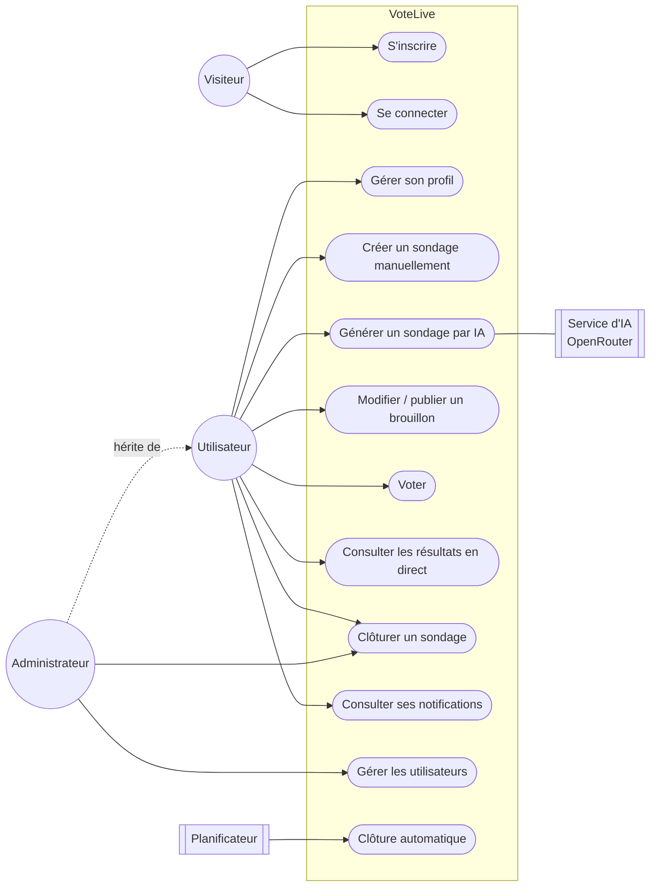

> **À expliquer à l'oral :** l'administrateur peut faire tout ce que fait un utilisateur (héritage), avec en plus la gestion des comptes. Le planificateur est un acteur « système » : c'est le serveur lui-même qui déclenche la clôture automatique.

---

## 9. Architecture générale

L'application suit une architecture **client-serveur en trois parties** :

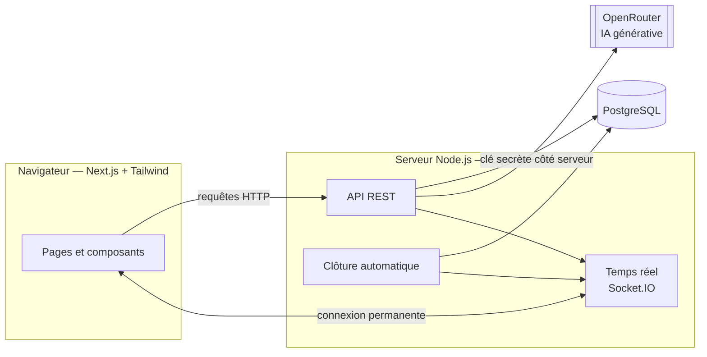

| Partie | Rôle |
|---|---|
| **Frontend (Next.js)** | Affiche les pages, envoie les actions de l'utilisateur, reçoit les mises à jour en direct. Il ne contient **aucun secret** et ne parle jamais directement à la base de données. |
| **Backend (Express)** | Contient toute la **logique métier** : authentification, règles de vote, cycle de vie des sondages, appels à l'IA, diffusion temps réel. |
| **Base de données (PostgreSQL)** | Stocke les données de façon durable et **garantit les règles d'intégrité** (unicité du vote, cohérence des liens). |
| **OpenRouter** | Service externe d'IA, appelé uniquement par le serveur. |

Le backend est organisé en **modules** (authentification, utilisateurs, sondages, votes, IA, notifications). Chaque module sépare la validation des données, les règles métier et l'accès à la base. C'est un **monolithe modulaire** : une seule application, bien découpée à l'intérieur, plus simple à déployer et à expliquer qu'une architecture en microservices.

---

## 10. Choix technologiques et justification

| Besoin | Technologie choisie | Justification |
|---|---|---|
| Interface utilisateur | **Next.js + React** | Framework moderne, routage par dossiers, composants réutilisables |
| Mise en forme | **Tailwind CSS** | Design cohérent et responsive, rapide à mettre en place |
| Identité visuelle | **Design éditorial** (Playfair Display, DM Sans, IBM Plex Mono, Amiri) | Une interface inspirée de la presse écrite : deux encres (papier crème et brun), titres en serif, chiffres en caractères à chasse fixe |
| Serveur | **Node.js + Express** | Imposé par le cahier des charges. Léger, très répandu, bien documenté. |
| Langage | **TypeScript** | Détecte de nombreuses erreurs avant l'exécution et rend le code plus lisible |
| Temps réel | **Socket.IO** | Imposé. Gère les *rooms*, la reconnexion automatique et les accusés de réception. |
| Base de données | **PostgreSQL** | Base relationnelle robuste : transactions, contraintes avancées, verrous de ligne |
| IA générative | **OpenRouter** | Une seule API pour accéder à de nombreux modèles d'IA. Le modèle se change par simple configuration. |
| Sécurité | **bcrypt, JWT, Helmet, CORS** | Standards reconnus pour le hachage, les sessions et la protection HTTP |
| Validation | **Zod** | Vérifie les données reçues (formulaires *et* réponses de l'IA) |
| Tests | **Vitest, Supertest** | Tests rapides de l'API et du temps réel |

### Identité visuelle : « l'éditorial marocain »

L'interface s'inspire de la **presse écrite** : chaque sondage est présenté comme un article, avec un grand titre, un chapeau et une signature, et le vote prend la forme d'un **bulletin imprimé**. Deux couleurs seulement sont utilisées, le papier crème et l'encre brune. La hiérarchie repose sur la typographie : titres en Playfair Display, interface en DM Sans, chiffres et dates en IBM Plex Mono. Une touche marocaine discrète complète l'ensemble : un sous-titre en arabe (« صوت الرأي », *la voix de l'opinion*) dans l'en-tête, comme dans la presse bilingue marocaine, et l'étoile à huit branches du zellige utilisée comme ornement typographique.

> **Remarque importante :** le cahier des charges mentionne MySQL. Nous avons choisi **PostgreSQL**, qui répond à toutes les exigences (relations, contrainte d'unicité, transactions) et offre en plus des fonctionnalités utiles au projet : clé étrangère composée, index partiel, verrous `FOR SHARE`. Ce choix doit être annoncé et justifié pendant la soutenance.

---

## 11. Conception de la base de données

La base contient **cinq tables** : les quatre tables demandées par le cahier des charges, plus une table de notifications.

| Table | Rôle | Champs principaux |
|---|---|---|
| `users` | Comptes des utilisateurs | identifiant, nom d'utilisateur, email, mot de passe **haché**, rôle, actif/inactif, dates |
| `polls` | Sondages | question, description, créateur, mode de création (manuel / IA), statut, visibilité des résultats, date de clôture, dates de publication et de clôture |
| `poll_options` | Propositions de réponse (nombre variable) | sondage associé, texte, position |
| `votes` | Votes enregistrés | sondage, utilisateur, proposition choisie, date du vote |
| `notifications` | Notifications de clôture | destinataire, sondage, message, lu / non lu |

### Règles d'intégrité garanties par la base

- **Un seul vote par utilisateur et par sondage** : contrainte `UNIQUE (poll_id, user_id)`.
- **La proposition choisie appartient bien au sondage voté** : clé étrangère composée `(option_id, poll_id)`. Sans elle, une simple clé étrangère accepterait un vote pour le sondage A avec une réponse du sondage B.
- **Pas de doublon** d'email, de nom d'utilisateur ou de proposition dans un même sondage.
- **Cohérence des statuts** : un sondage clôturé a obligatoirement une date de clôture.
- **Suppression en cascade** : supprimer un sondage supprime ses propositions, ses votes et ses notifications.

### Pourquoi une base relationnelle ?

Les données sont **fortement liées** entre elles (un vote dépend d'un utilisateur, d'un sondage et d'une proposition) et soumises à des **règles strictes**. Une base relationnelle permet de faire respecter ces règles **par la base elle-même**, même si le code applicatif contenait une erreur.

Les nombres de votes ne sont **jamais stockés** : ils sont **recalculés** à partir de la table `votes`, ce qui évite toute incohérence.

---

## 12. Diagramme entité-association

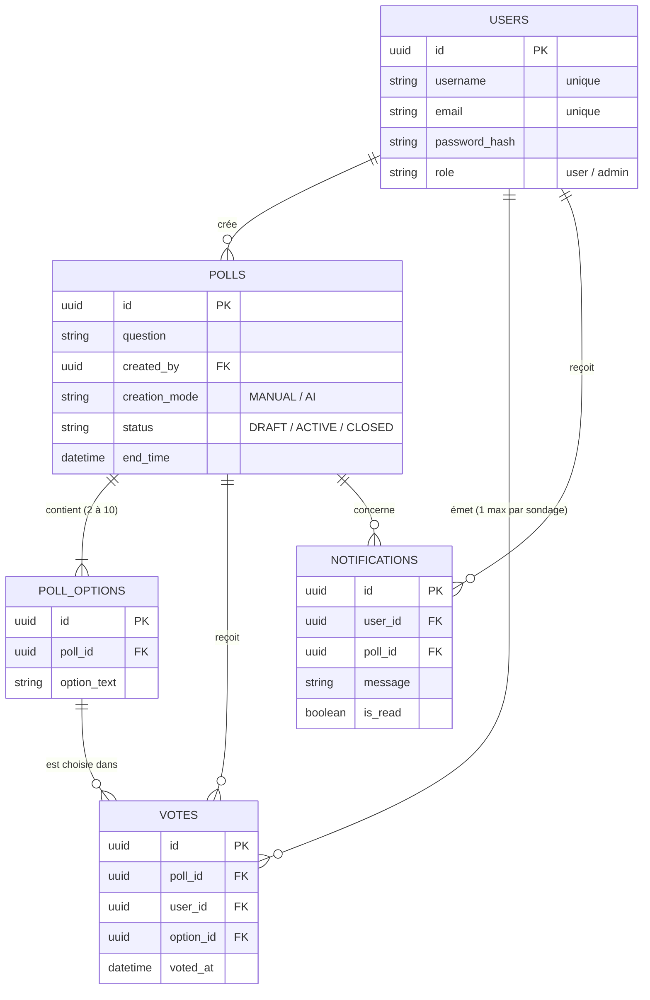

**Cardinalités à retenir :**

- un utilisateur crée **0 à N** sondages ;
- un sondage contient **2 à 10** propositions ;
- un utilisateur vote dans **plusieurs** sondages, mais **une seule fois** par sondage ;
- chaque vote correspond à **une** proposition **du même** sondage.

---

## 13. Fonctionnement de l'authentification

### Inscription et connexion

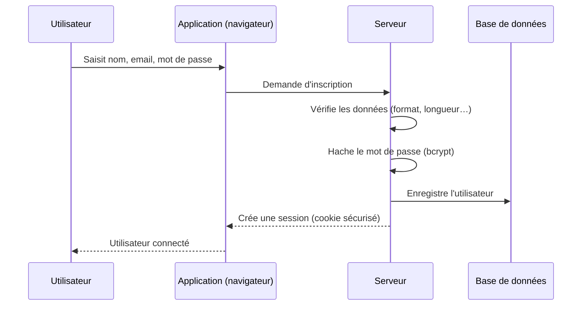

**Points clés à présenter :**

1. **Hachage du mot de passe** : le mot de passe n'est jamais stocké en clair. Il est transformé par **bcrypt** en une empreinte irréversible. Un « sel » aléatoire fait que deux mots de passe identiques donnent des empreintes différentes.
2. **Jeton de session (JWT)** : après la connexion, le serveur délivre un jeton signé, valable une journée. Il est rangé dans un **cookie protégé** (*httpOnly*) que le code JavaScript de la page ne peut pas lire, ce qui protège contre le vol de session.
3. **Vérification à chaque requête** : le serveur vérifie la signature du jeton et recharge l'utilisateur. Un compte désactivé est donc bloqué **immédiatement**.
4. **Messages prudents** : en cas d'échec de connexion, le message est le même que l'email soit inconnu ou que le mot de passe soit faux. Ainsi, un pirate ne peut pas deviner quels comptes existent.

### Authentification ≠ autorisation

| Notion | Question posée | Exemple dans VoteLive |
|---|---|---|
| **Authentification** | *Qui êtes-vous ?* | Vérification du jeton de session |
| **Autorisation** | *Avez-vous le droit ?* | Seul le créateur peut modifier son brouillon. Seul un administrateur gère les comptes. |

---

## 14. Création manuelle des sondages

### Cycle de vie d'un sondage

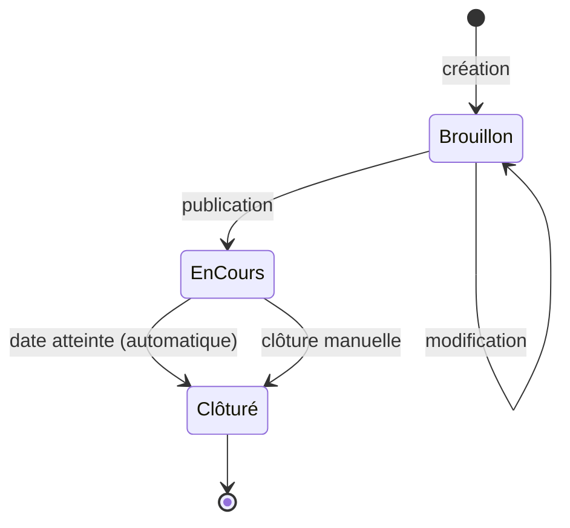

| Statut | Signification | Actions possibles |
|---|---|---|
| **Brouillon** | Visible uniquement par son créateur | Modifier, publier, supprimer |
| **En cours** | Publié, les votes sont ouverts | Voter, voir les résultats, clôturer |
| **Clôturé** | Terminé, résultats définitifs | Consulter les résultats |

### Règles appliquées

- une question de **5 à 300 caractères** ;
- de **2 à 10 propositions**, toutes **différentes** ;
- une date de clôture **dans le futur** (au moins 1 minute, au plus 1 an) ;
- **un sondage publié ne peut plus être modifié**, pour ne pas changer le sens des votes déjà exprimés ;
- au moment de la publication, le serveur **revérifie** que la date de clôture est toujours valide.

Le créateur choisit aussi la **visibilité des résultats** :

- **En temps réel** : tout le monde voit l'évolution pendant le vote ;
- **Après la clôture** : seuls le nombre total de votes et le créateur voient l'avancement. Les résultats détaillés sont publiés à la fin, ce qui évite d'influencer les votants.

---

## 15. Génération intelligente avec OpenRouter

### Principe

L'utilisateur saisit un **thème** (par exemple « le télétravail »), le **nombre de propositions** souhaitées, la **langue** et éventuellement des **consignes**. Le serveur interroge un modèle d'IA via **OpenRouter** et renvoie une **proposition** de sondage.

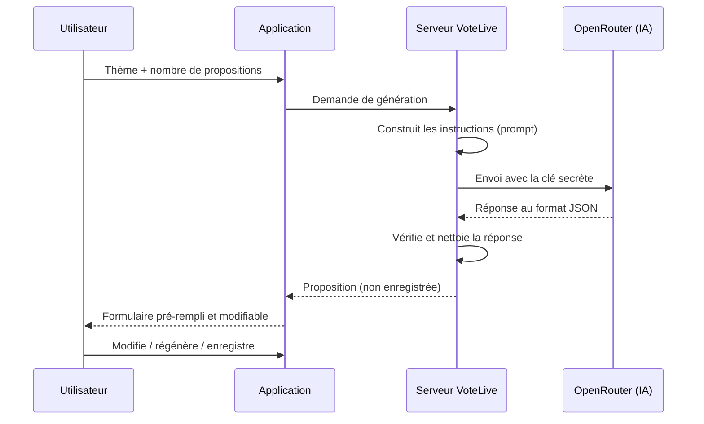

### Les points essentiels

1. **La clé de l'IA reste sur le serveur.** Le navigateur ne contacte jamais OpenRouter directement.
2. **Des instructions précises (prompt).** Nous demandons une question **claire et neutre**, le nombre exact de propositions, sans numérotation, et une réponse **uniquement au format JSON**, par exemple :
   ```json
   { "question": "À quelle fréquence souhaitez-vous télétravailler ?", "options": ["Jamais", "1 à 2 jours", "3 à 4 jours", "Tous les jours"] }
   ```
3. **Le serveur ne fait pas confiance aveuglément à l'IA.** Il vérifie que la réponse est bien du JSON, qu'elle respecte le format attendu et qu'il n'y a pas de doublon. Il fait **une nouvelle tentative** si la réponse est mal formée.
4. **Gestion des pannes.** Si l'IA est trop lente, indisponible, saturée ou à court de crédits, l'utilisateur reçoit un message clair. La création manuelle reste toujours possible.
5. **L'humain garde le contrôle.** La proposition **n'est jamais publiée automatiquement**. Elle s'affiche d'abord comme une « épreuve », puis elle est reprise dans le formulaire, où l'utilisateur peut tout modifier, **demander une autre version**, puis enregistrer. Le sondage est marqué « créé avec l'IA » pour la traçabilité.

> **À expliquer à l'oral :** une IA générative peut se tromper ou produire une réponse mal structurée. Notre application traite donc sa réponse comme une donnée externe à contrôler, au même titre qu'une saisie utilisateur.

---

## 16. Processus de vote sécurisé

C'est la partie la plus importante du projet. Lorsqu'un utilisateur vote, le serveur vérifie **six conditions** :

| # | Vérification | Si elle échoue |
|---|---|---|
| 1 | L'utilisateur est connecté | Refus (non authentifié) |
| 2 | Le sondage existe | « Sondage introuvable » |
| 3 | Le sondage est en cours | « Ce sondage est clôturé » |
| 4 | La date de clôture n'est pas dépassée | « Ce sondage est clôturé » |
| 5 | La proposition appartient à ce sondage | « Proposition invalide » |
| 6 | L'utilisateur n'a pas déjà voté | « Vous avez déjà voté » |

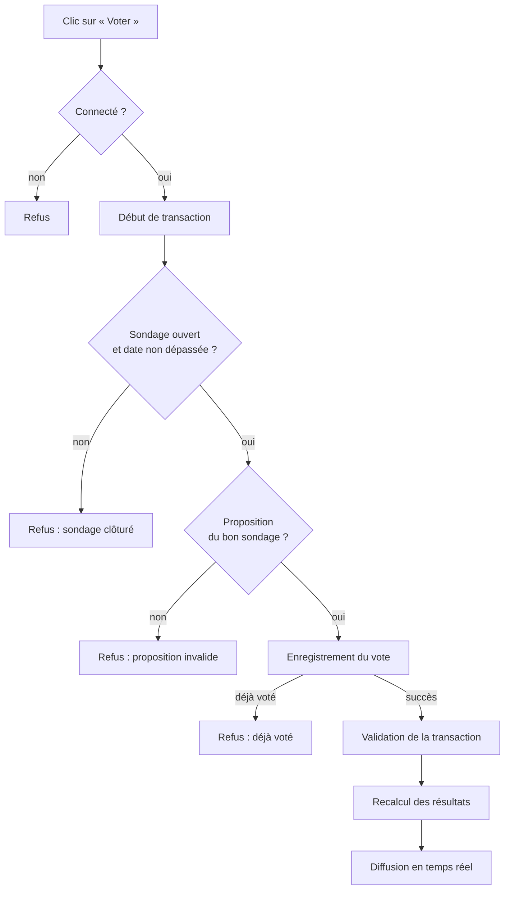

### Comment empêche-t-on les votes multiples ?

- **Côté interface**, le bulletin est verrouillé après le vote et marqué du tampon « A voté ». Ce n'est **pas** une protection suffisante, car une requête peut être envoyée sans passer par l'interface.
- **Côté serveur**, toutes les vérifications sont refaites.
- **Côté base de données**, la contrainte `UNIQUE (poll_id, user_id)` rend **physiquement impossible** l'enregistrement de deux votes pour le même utilisateur et le même sondage.

### Le cas des votes simultanés

Si un utilisateur clique deux fois très rapidement, deux requêtes arrivent au même moment. Une simple vérification « a-t-il déjà voté ? » pourrait laisser passer les deux. Grâce à la contrainte d'unicité, PostgreSQL n'accepte que **le premier** vote et rejette le second.

Nous l'avons vérifié par un test automatisé : **10 votes envoyés en même temps par le même utilisateur donnent exactement 1 vote enregistré.**

### Transaction

Le vote est enregistré dans une **transaction** : soit toutes les étapes réussissent, soit rien n'est enregistré. Pendant la transaction, le sondage est **verrouillé en lecture partagée**. Une clôture ne peut donc pas se produire au milieu d'un vote, et les résultats définitifs incluent bien tous les votes acceptés.

Les résultats ne sont diffusés **qu'après** la validation définitive du vote, jamais avant.

---

## 17. Communication en temps réel avec Socket.IO

### HTTP classique ou connexion permanente ?

| HTTP classique | WebSocket (Socket.IO) |
|---|---|
| Le navigateur demande, le serveur répond, puis la communication s'arrête | La connexion **reste ouverte** |
| Pour voir un nouveau vote, il faut recharger ou redemander | Le serveur **envoie** lui-même les nouveaux résultats |
| Adapté aux actions (créer, voter…) | Adapté aux **notifications instantanées** |

VoteLive utilise **les deux** : HTTP pour les actions (dont le vote) et Socket.IO pour **prévenir** les autres utilisateurs.

### Les « rooms » (salons)

Chaque sondage possède son propre salon, nommé `poll:<identifiant>`. Quand un utilisateur ouvre la page d'un sondage, il **rejoint** ce salon, et il le **quitte** en changeant de page. Les mises à jour d'un sondage sont envoyées **uniquement** aux personnes de son salon. Un vote sur le sondage A n'est jamais envoyé aux personnes qui regardent le sondage B. C'est une exigence du cahier des charges, vérifiée par un test.

Chaque utilisateur possède aussi un **salon personnel**, qui sert à recevoir ses notifications où qu'il se trouve dans l'application.

### Les événements utilisés

| Événement | Sens | Rôle |
|---|---|---|
| `poll:join` | navigateur → serveur | Rejoindre le salon d'un sondage (le serveur renvoie les résultats actuels) |
| `poll:leave` | navigateur → serveur | Quitter le salon |
| `poll:results` | serveur → salon du sondage | Nouveaux résultats après chaque vote |
| `poll:closed` | serveur → salon du sondage | Le sondage vient d'être clôturé (résultats définitifs) |
| `notification:new` | serveur → salon personnel | Nouvelle notification |

**Sécurité :** la connexion temps réel utilise la même session que le reste de l'application. Un visiteur non connecté ne peut pas s'y connecter.

> **Démonstration conseillée :** ouvrir deux navigateurs avec deux comptes différents sur le même sondage, voter dans l'un, et montrer que les barres de l'autre bougent instantanément.

---

## 18. Clôture automatique des sondages

Deux mécanismes **complémentaires** sont utilisés :

| Mécanisme | Rôle |
|---|---|
| **Vérification à chaque vote** | Le serveur compare l'heure actuelle à la date de clôture **à chaque vote**. Un vote arrivé une seconde trop tard est refusé, même si le sondage n'a pas encore été officiellement fermé. |
| **Tâche planifiée** (toutes les 5 secondes) | Le serveur recherche les sondages arrivés à échéance, change leur statut en « Clôturé », crée les notifications pour le créateur et les votants, puis prévient les utilisateurs connectés. |

Le cahier des charges demande que la vérification de la date soit faite **côté serveur, indépendamment des notifications**. C'est exactement le rôle du premier mécanisme. Même si la tâche planifiée s'arrêtait, aucun vote tardif ne serait accepté.

Quelques précautions supplémentaires :

- au **démarrage du serveur**, la tâche s'exécute immédiatement, pour fermer les sondages expirés pendant un arrêt ;
- le changement de statut et la création des notifications sont faits **ensemble** (dans une même transaction) ;
- un utilisateur ne reçoit **jamais deux fois** la même notification ;
- les notifications sont **enregistrées en base** : un utilisateur hors ligne les retrouve à sa prochaine connexion.

---

## 19. Sécurité et gestion des erreurs

### Principales mesures de sécurité

| Risque | Protection |
|---|---|
| Vol de la base de données | Mots de passe hachés avec bcrypt |
| Essais de mots de passe en série | Limitation du nombre de tentatives de connexion |
| Vol de session | Jeton dans un cookie inaccessible au JavaScript |
| Injection SQL | Requêtes **paramétrées** : les données ne sont jamais insérées directement dans le SQL |
| Accès non autorisé | Vérification du rôle et du propriétaire côté serveur |
| Votes multiples | Contrainte d'unicité dans PostgreSQL |
| Votes après la clôture | Vérification de la date à chaque vote |
| Exposition de la clé de l'IA | Clé uniquement sur le serveur, dans un fichier non versionné |
| Abus de l'IA (coût) | Connexion obligatoire et limite de 10 générations par minute |
| Requêtes d'autres sites | Liste blanche d'origines autorisées (CORS) et cookie *SameSite* |
| Fuite d'informations techniques | Messages d'erreur génériques. Les détails restent dans les journaux du serveur. |

### Gestion des erreurs

Toutes les erreurs passent par un **gestionnaire central** qui renvoie toujours le même format, avec un code et un message lisible :

| Situation | Message affiché (exemple) |
|---|---|
| Erreur de saisie | « Un sondage doit contenir au moins 2 propositions » (sous le champ concerné) |
| Mauvais identifiants | « Email ou mot de passe incorrect » |
| Vote multiple | « Vous avez déjà voté pour ce sondage » |
| Vote après la clôture | « Ce sondage est clôturé, il n'est plus possible de voter » |
| IA indisponible | « Le service d'IA est momentanément indisponible, réessayez plus tard » |
| Réponse de l'IA invalide | « L'IA a renvoyé une réponse inexploitable, veuillez régénérer » |
| Base de données indisponible | « Service momentanément indisponible, réessayez plus tard » |
| Page inexistante | Page « 404 — Page introuvable » |

---

## 20. Tests et validation

### Types de tests

- **Tests unitaires** : ils vérifient une petite fonction isolée (par exemple le nettoyage de la réponse de l'IA).
- **Tests d'intégration et d'API** : ils envoient de vraies requêtes au serveur, connecté à une vraie base PostgreSQL de test. C'est la catégorie principale, car les garanties les plus importantes (vote unique, cohérence) reposent sur la base de données.
- **Tests temps réel** : de vrais clients Socket.IO se connectent à un serveur de test.
- **IA simulée** : pendant les tests, le service OpenRouter est **simulé**. Cela permet de reproduire les pannes (délai dépassé, crédits insuffisants, réponse invalide) sans frais.

### Résultats

**63 tests automatisés, tous réussis** (5 fichiers) :

| Domaine | Nombre | Exemples de scénarios |
|---|---|---|
| Authentification | 11 | inscription réussie, identifiants invalides, requête non authentifiée, compte désactivé |
| Sondages | 17 | création, données invalides, modification interdite à un autre utilisateur, publication |
| Votes | 13 | vote réussi, double vote, vote après expiration, proposition invalide, **10 votes simultanés → 1 seul accepté** |
| IA | 16 | génération réussie, réponse invalide, API indisponible, délai dépassé, crédits insuffisants |
| Temps réel | 6 | isolation des salons, mise à jour des résultats, notification de clôture |

En complément, l'interface a été vérifiée par la **compilation TypeScript**, l'**analyse ESLint**, la **construction de production** de Next.js et des **essais manuels** dans le navigateur.

> **À dire honnêtement au jury :** l'interface (frontend) n'a pas de tests automatisés, et l'appel réel à OpenRouter n'est pas testé automatiquement (il est simulé dans les tests). Il a été vérifié manuellement avec une vraie clé, et le parcours complet (vote en direct entre deux utilisateurs, clôture automatique, notification) a été vérifié dans un navigateur.

---

## 21. Captures d'écran de l'application

Les captures suivantes proviennent de l'application en fonctionnement (données de démonstration).

**Page d'accueil pour un visiteur**


**Connexion**

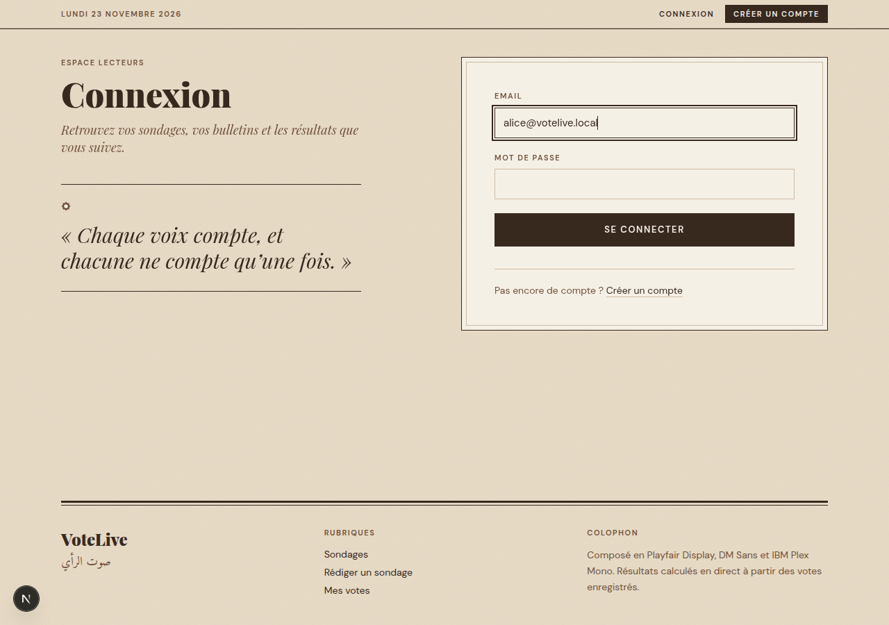

**La une (utilisateur connecté)** : le sondage le plus suivi en tête de page, les plus suivis, les dernières publications et les résultats définitifs.

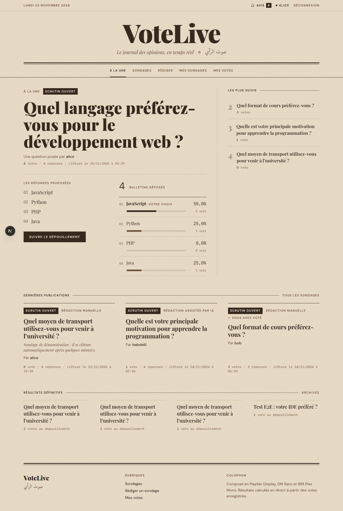

**Liste des sondages**


**Page d'un sondage avant le vote** (bulletin de vote imprimé)


**Résultats en temps réel** : le vote d'un autre utilisateur apparaît sans recharger la page, puis le bulletin est marqué « A voté » après son propre vote.


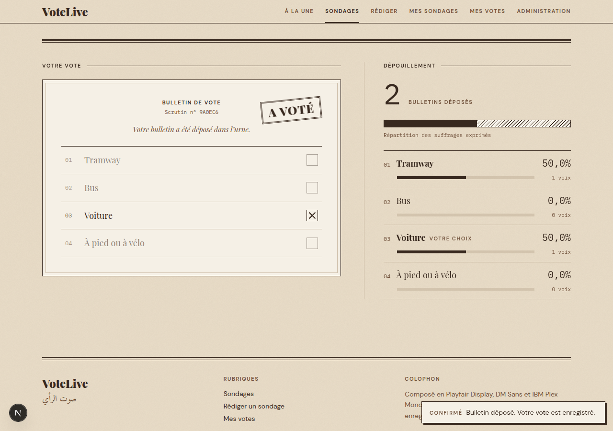

**Sondage dont les résultats sont publiés à la clôture** (« sous embargo »)

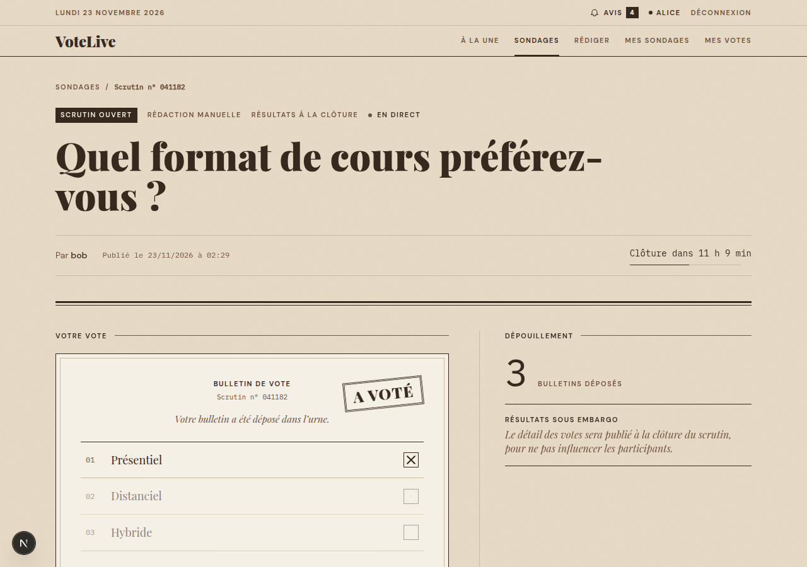

**Création manuelle**, avec le guide de rédaction

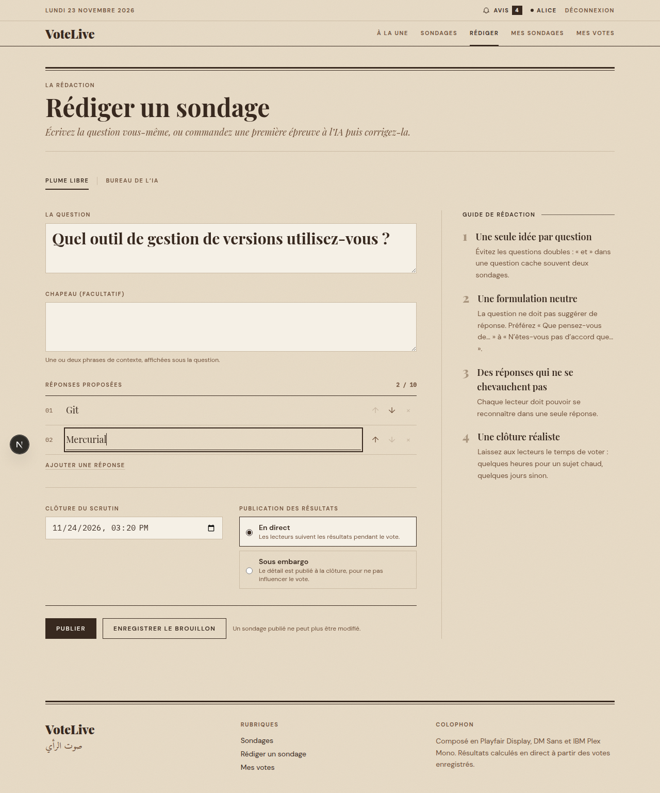

**Génération par IA** : la commande à gauche, l'épreuve renvoyée par le modèle à droite (vraie réponse d'OpenRouter)

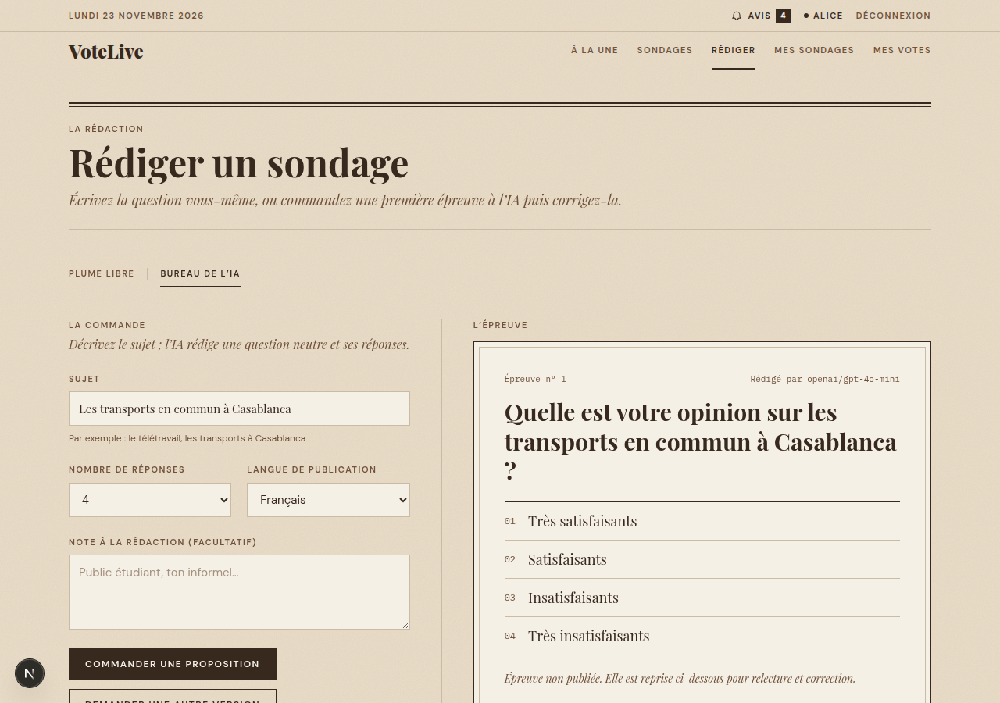

**Relecture de la proposition de l'IA** dans le formulaire, avant enregistrement

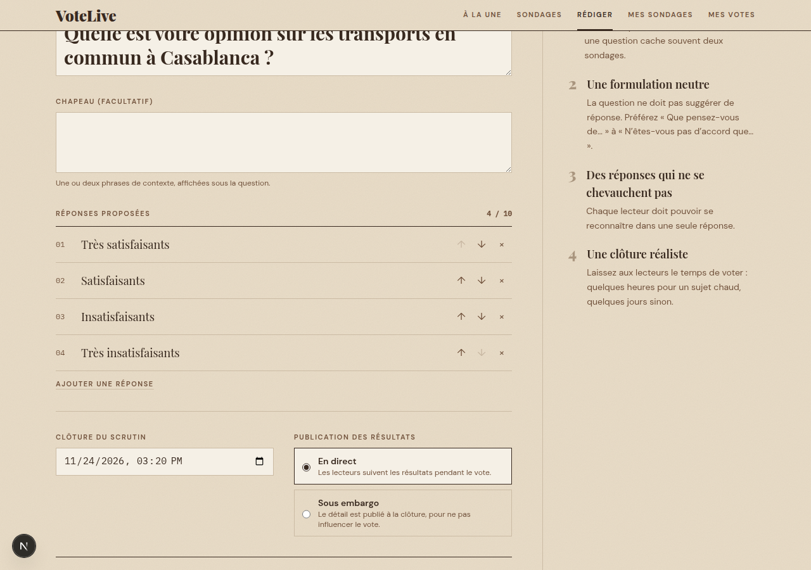

**Mes sondages**


**Clôture automatique en direct** : la page ouverte passe d'elle-même en « Scrutin clos » et affiche les résultats définitifs.


**Avis de clôture (notifications)**


**Administration des comptes**

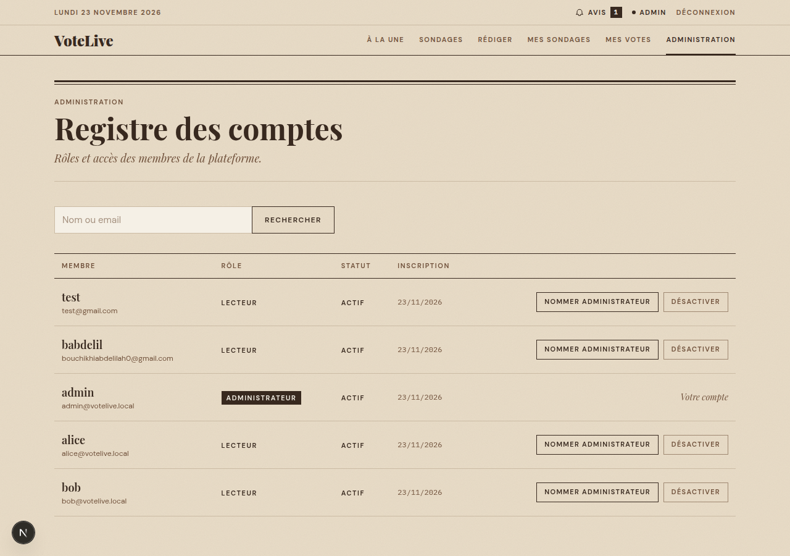

> 📸 **[CAPTURE À INSÉRER — `docs/screenshots/11-tests.png`]** : capture du terminal après la commande `npm test` dans le dossier `backend`, montrant « Test Files 5 passed » et « Tests 63 passed ».

**Version mobile**


---

## 22. Difficultés rencontrées et solutions

| Difficulté | Solution retenue |
|---|---|
| **Votes simultanés** : deux clics rapides pouvaient, en théorie, enregistrer deux votes, car une vérification préalable ne suffit pas. | Confier la règle à la base de données (contrainte d'unicité) et traduire son refus en message clair. Vérifié par un test de 10 votes simultanés. |
| **Vote pendant la clôture** : un vote pouvait être accepté au moment exact où le sondage se fermait, après le calcul des résultats définitifs. | Verrouiller le sondage pendant le vote (verrou partagé) : la clôture attend la fin des votes en cours. |
| **Diffuser un vote non enregistré** : envoyer les résultats trop tôt aurait pu afficher un vote finalement annulé. | Diffuser **uniquement après** la validation définitive de la transaction, avec des résultats recalculés depuis la base. |
| **Réponses de l'IA mal formées** : texte autour du JSON, numérotation, doublons, mauvais nombre de propositions. | Extraction tolérante du JSON, validation stricte du format, nettoyage, nouvelle tentative, puis message invitant à régénérer. |
| **Pannes du service d'IA** : lenteur, saturation, crédits épuisés. | Délai maximal de 20 secondes et message adapté à chaque cas. La création manuelle reste disponible. |
| **Résultats masqués jusqu'à la clôture** : les mises à jour en direct ne devaient pas révéler les résultats aux votants. | Diffuser une version « publique » (total uniquement). Le créateur recharge sa propre vue détaillée. |
| **Perte des salons après une coupure réseau** : à la reconnexion, le navigateur n'était plus dans le salon du sondage. | Rejoindre automatiquement le salon à chaque (re)connexion. |
| **Session entre deux ports** (frontend sur 3000, serveur sur 5000) | Cookie partagé sur `localhost`, CORS configuré avec autorisation des identifiants. |
| **Évolution du schéma de la base** : la première version modifiait la structure automatiquement au démarrage, ce qui était risqué. | Passage à des **migrations** SQL versionnées, appliquées de façon contrôlée. |
| **Changement de base de données** (MySQL → PostgreSQL) | Adaptation du modèle et exploitation des fonctionnalités de PostgreSQL (clé étrangère composée, index partiel, verrous). |

---

## 23. Résultats obtenus

Toutes les fonctionnalités demandées dans le cahier des charges sont réalisées :

- ✅ Base de données PostgreSQL conçue avec ses relations et ses contraintes
- ✅ Backend Node.js / Express (TypeScript), organisé en modules
- ✅ Inscription, authentification, profils, rôles administrateur / utilisateur
- ✅ Création, modification, publication et clôture des sondages
- ✅ Génération de sondages par IA (OpenRouter), avec vérification, modification et régénération avant enregistrement
- ✅ Système de vote sécurisé : un vote par utilisateur, refus après la clôture
- ✅ Résultats en temps réel avec Socket.IO et des salons isolés par sondage
- ✅ Clôture automatique et notifications en temps réel (et enregistrées)
- ✅ Gestion des erreurs et règles de sécurité
- ✅ Interface Next.js / Tailwind complète et adaptée au mobile
- ✅ 63 tests automatisés réussis
- ✅ Documentation de l'API (Swagger) et documentation technique

---

## 24. Limites et perspectives d'amélioration

### Limites actuelles

- **Déconnexion** : le jeton de session reste techniquement valable jusqu'à son expiration (1 jour) s'il a été copié. Le compte peut toutefois être désactivé immédiatement.
- **Un seul serveur** : le temps réel et la limitation des requêtes fonctionnent en mémoire. Plusieurs serveurs nécessiteraient un outil partagé (par exemple Redis).
- **Clôture** : le changement de statut peut avoir jusqu'à 5 secondes de décalage (les votes tardifs sont tout de même refusés à la seconde près).
- **Qualité de l'IA** : les propositions peuvent être imparfaites. C'est pourquoi la relecture humaine est obligatoire.
- **Tests** : pas de tests automatisés de l'interface.
- **Fonctionnalités de compte** : pas de vérification d'email ni de réinitialisation du mot de passe.
- **Type de sondage** : un seul choix par vote.

### Perspectives

1. Sessions renouvelables avec possibilité de révocation, réinitialisation du mot de passe par email.
2. Sondages à choix multiples ou à classement, export des résultats (CSV), graphiques supplémentaires.
3. Tests de bout en bout de l'interface (Playwright) et intégration continue.
4. Déploiement sur plusieurs serveurs (Redis pour Socket.IO).
5. Modération automatique des contenus générés et choix automatique d'un modèle de secours en cas de panne.
6. Conteneurisation complète (Docker) pour un déploiement en une commande.

---

## 25. Conclusion

Ce projet nous a permis de concevoir et de réaliser une application web complète, qui répond à une problématique concrète : **organiser des sondages fiables, réactifs et assistés par l'intelligence artificielle**.

Sur le plan technique, nous avons mis en pratique :

- la **conception d'une base de données relationnelle**, dont les contraintes garantissent l'intégrité des votes ;
- le développement d'une **API REST sécurisée** avec Express ;
- la **communication en temps réel** avec Socket.IO et l'isolation des salons ;
- l'**intégration d'une IA générative**, en traitant ses réponses avec prudence ;
- la gestion de la **concurrence**, des **transactions** et des **erreurs** ;
- les **tests automatisés** pour valider le comportement de l'application.

Nous retenons surtout qu'une application fiable ne repose pas sur l'interface, mais sur des **règles vérifiées côté serveur et garanties par la base de données**. VoteLive constitue une base solide, qui pourrait évoluer vers un véritable produit grâce aux améliorations proposées.

---

## Annexe — Conseils pour la soutenance

### Proposition de répartition de la présentation

| Partie | Contenu | Durée indicative |
|---|---|---|
| Introduction | Contexte, problématique, objectifs (sections 2 à 4) | 3 min |
| Analyse et conception | Besoins, cas d'utilisation, architecture, base de données (sections 5 à 12) | 6 min |
| Fonctionnalités clés | Authentification, sondages, IA, vote sécurisé (sections 13 à 16) | 6 min |
| Temps réel et clôture | Socket.IO, rooms, clôture automatique (sections 17 et 18) | 4 min |
| Démonstration | Application en direct (voir ci-dessous) | 6 min |
| Qualité et bilan | Sécurité, tests, difficultés, résultats, perspectives, conclusion | 5 min |

*La répartition entre Salma et Meryem peut se faire par blocs (par exemple : l'une présente l'analyse, la base de données et le vote ; l'autre l'IA, le temps réel et la démonstration).*

### Scénario de démonstration

1. Se connecter avec **alice@votelive.local** (mot de passe `Alice1234`) dans un navigateur, et avec **bob@votelive.local** (`Bob12345`) dans une fenêtre de navigation privée.
2. Ouvrir le même sondage dans les deux fenêtres. Voter avec Bob et montrer la mise à jour **instantanée** chez Alice.
3. Montrer qu'un second vote est refusé (« Vous avez déjà voté »).
4. Créer un sondage avec l'**IA**, modifier une proposition, l'enregistrer en brouillon, puis le publier.
5. Créer un sondage qui se termine dans 2 minutes et montrer la **clôture automatique** et la notification.
6. Montrer la page **Administration** avec le compte administrateur.

### Questions fréquentes du jury

| Question | Éléments de réponse |
|---|---|
| *Comment empêchez-vous un double vote ?* | Vérification par le serveur et contrainte `UNIQUE (poll_id, user_id)` dans PostgreSQL. Testé avec 10 votes simultanés. |
| *Et si quelqu'un vote juste après la date de clôture ?* | Le serveur compare la date à chaque vote, indépendamment de la tâche de clôture. |
| *Pourquoi PostgreSQL et non MySQL ?* | Mêmes garanties de base, plus des fonctionnalités utiles (clé étrangère composée, index partiel, verrous). |
| *Où est stockée la clé de l'IA ?* | Uniquement sur le serveur, dans un fichier d'environnement non versionné. Le navigateur ne la voit jamais. |
| *Que se passe-t-il si l'IA ne répond pas ?* | Délai maximal, message clair, possibilité de régénérer. La création manuelle reste disponible. |
| *À quoi servent les rooms Socket.IO ?* | À n'envoyer les résultats d'un sondage qu'aux personnes qui le consultent. |
| *Différence entre authentification et autorisation ?* | Authentification : *qui êtes-vous ?* Autorisation : *avez-vous le droit ?* |
| *Pourquoi ne pas stocker le nombre de votes ?* | Pour éviter les incohérences : les résultats sont toujours recalculés à partir des votes enregistrés. |
